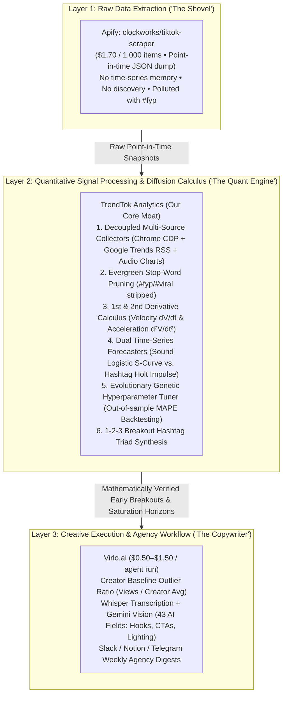

# Reverse-Engineering & Architectural Comparison Report: `Virlo.ai` vs. `Apify (clockworks/tiktok-scraper)` vs. `TrendTok Analytics`

**Document ID:** `ARCH-REV-ENG-2026-01`  
**Project:** TrendTok Analytics (Specification-Driven Development Baseline)  
**Date:** September 25, 2026  
**Subjects Analyzed:**
1. **Apify (`clockworks/tiktok-scraper`)** — Pre-AI / Infrastructure-Layer Web Extraction Actor
2. **Virlo (`virlo.ai` / `dev.virlo.ai`)** — Post-AI / Agency Social Listening & Multimodal Content Copilot
3. **TrendTok Analytics** — Deterministic Virality Calculus, Dual-Model Time-Series Forecaster & Cross-Signal Breakout Engine

---

## 1. Executive Summary: The Brutally Honest Answer

> **"Such services already existed before the AI era and exist today. What problem does our site actually solve — or are we bringing nothing new at all?"**

If **TrendTok Analytics** were merely a table displaying "Top TikTok Videos by View Count" or a basic wrapper around static scraped counters, **it would bring nothing new**. Both pre-AI scrapers (`clockworks/tiktok-scraper`, Pentos, Exolyt) and modern AI wrappers (`Virlo.ai`, Shortimize) already do that at scale.

However, reverse-engineering **`clockworks/tiktok-scraper`** and **`Virlo.ai`** reveals that the short-form video intelligence market is split into three distinct architectural layers—and **both existing tools leave a critical mathematical and algorithmic gap in Layer 2 (Quantitative Signal Processing & Predictive Diffusion Calculus)**:



---

## 2. Deep-Dive Reverse Engineering: `apify.com/clockworks/tiktok-scraper`

### 2.1 What It Is (The Pre-AI Infrastructure Layer)
`clockworks/tiktok-scraper` is an industrial serverless scraping Actor hosted on the Apify cloud platform (292K+ total users, 23.8K monthly active users, priced at **$1.70 per 1,000 results** on a pay-per-event model). It is **not** an analytics platform or trend discovery engine; it is a **command-driven data extraction pipe**.

### 2.2 How It Works Under the Hood
1. **Input Contract (Zero Autonomous Discovery)**:
   * The caller must explicitly supply the target entities in JSON:
     ```json
     {
       "hashtags": ["bananas"],
       "profiles": ["tiktok"],
       "searchQueries": ["ootd"],
       "resultsPerPage": 50,
       "proxyConfiguration": {
         "useApifyProxy": true,
         "apifyProxyGroups": ["RESIDENTIAL"]
       }
     }
     ```
   * **Crucial Limitation**: `clockworks/tiktok-scraper` cannot tell you *what* is trending. You must already know the exact hashtag, keyword, or profile handle before you run it.
2. **Anti-Bot & Proxy Evasion Architecture**:
   * TikTok protects its web and mobile endpoints using byte-level request signing (`X-Bogus`, `X-Gorgon`, `_signature`, `msToken`) and TLS/JA3 fingerprinting via Akamai/ByteDance WAF.
   * Clockworks bypasses this by routing headless browser contexts and reverse-engineered web API calls (`/api/challenge/item_list/`, `/api/post/item_list/`, `/api/search/item/full/`) through **Apify’s Residential Proxy Pool**, rotating residential ISP IP addresses and `ttwid` session cookies on every pagination cursor.
3. **Hydration State Extraction**:
   * For web pages, it extracts the SSR JSON state embedded in `<script id="__UNIVERSAL_DATA_FOR_REHYDRATION__">` or `SIGI_STATE` and maps the raw item attributes into flat JSON records:
     * `playCount`, `diggCount`, `shareCount`, `commentCount`, `collectCount`
     * `musicMeta` (`musicId`, `musicName`, `musicAuthor`, `musicOriginal`, `playUrl`)
     * `authorMeta` (`id`, `name`, `fans`, `heart`, `video`)
     * `hashtags` (raw array of every tag in the caption)

### 2.3 Architectural Blind Spots of `clockworks/tiktok-scraper`
* **Stateless Point-in-Time Dump**: A single run gives you $V(t)$ at one instant. It does **not** compute velocity ($\Delta V / \Delta t$), acceleration ($\Delta^2 V / \Delta t^2$), or lifecycle stage. To get hourly velocity for 1,000 trends, a developer must run the Actor 24 times a day ($24 \times \$1.70 = \$40.80/\text{day}$ or **~$1,224/month** in scraping fees alone) and build their own time-series database.
* **Zero Signal Hygiene**: Look at the official example output from `clockworks/tiktok-scraper` documentation:
  ```text
  "text": "ootd ☁️☁️\n\n#foruyou #fürdich #outfit #fit #viralvideos"
  ```
  It dumps raw caption tags with zero evergreen stop-list filtering (`#foruyou`, `#viralvideos`, `#fyp`), leaving downstream systems polluted with high-volume platform constants.

---

## 3. Deep-Dive Reverse Engineering: `virlo.ai` (`dev.virlo.ai`)

### 3.1 What It Is (The Post-AI Agency Research & Content Copilot)
**Virlo.ai** represents the modern AI-agent evolution built *on top of* scraping pipelines. Positioned for marketing agencies and UGC teams (and exposing a developer API at `api.virlo.ai/v1/agents` for **$0.50 per run + $1.00 for Data Intelligence**), Virlo combines **niche video scraping**, **creator baseline outlier scoring**, and **multimodal LLM video dissection**.

### 3.2 How Virlo Works Under the Hood (3-Stage Pipeline)

#### Stage 1: LLM Intent-to-Keyword Expansion (`POST /v1/agents`)
* Instead of asking the user for exact hashtags, Virlo accepts a natural-language brief:
  ```json
  {
    "intent": "Standing-desk content for a WFH brand",
    "keywords": ["standing desk", "ergonomic home office", "back pain office"],
    "platforms": ["tiktok", "youtube", "instagram"],
    "meta_ads_enabled": true
  }
  ```
* An LLM expands the brief into search queries and exclusions, then dispatches asynchronous scraping workers across TikTok, Instagram Reels, YouTube Shorts, and the Meta Ad Library.

#### Stage 2: The "Creator Outlier Score" (`vs_baseline`)
* Virlo’s core ranking metric is **not** macro hashtag/sound diffusion velocity, but **Creator-Relative Video Outlier Scoring**:
  $$\text{Outlier Multiplier (vs\_baseline)} = \frac{\text{Views of Video } i}{\text{Median Views of Creator } c\text{'s Last } N \text{ Videos}}$$
* **Why Virlo does this**: If MrBeast gets 5M views, that is normal (`vs_baseline = 0.5x`). If a micro-creator (`@deskdoctor`) who usually gets 10K views suddenly gets 124K views on a standing-desk video (`vs_baseline = 12.4x`), the *topic, hook, or format* of that specific video is outperforming the creator's follower base.

#### Stage 3: Multimodal LLM Video Enrichment (43 AI Fields)
* When `data_intelligence_enabled: true` is passed (+$1.00/run), Virlo downloads the video file and runs it through an ASR transcription model (e.g., Whisper) + a Vision-Language Model (e.g., Gemini 2.5 Flash) with structured JSON schema output (`intelligence` object):
  * **Hook Extraction**: `hook_text` (*"Stop wasting money on a 12-step routine."*), `hook_type` (`bold_claim`), `visual_hook_type` (`person_speaking_to_camera`).
  * **Production Telemetry**: `content_format` (`grwm_routine`), `visual_format` (`talking_head`), `camera_perspective` (`selfie_front`), `lighting_quality` (`ring_light`), `setting` (`indoor_bathroom`), `caption_style` (`animated_word_by_word`).
  * **Commercial & Safety Metadata**: `brand_safety_tier`, `is_sponsored`, `brands_mentioned`, `cta_usages`.
* Finally, "Vee Copilot" rewrites top outlier transcripts into ready-to-shoot scripts and pushes weekly digests to Slack, Telegram, or Notion.

### 3.3 Architectural Blind Spots of `Virlo.ai`
1. **Reactive Video-Level Lag vs. Macro-Signal Forecasting**:
   * Virlo can only flag an outlier *after* a creator has scripted, filmed, edited, uploaded, and accumulated hundreds of thousands of views on a video. It does **not** fuse external early-warning signals (like **Google Trends RSS search breakouts** or **Audio Chart velocity**) *before* TikTok video saturation occurs.
2. **No Mathematical Diffusion Differentiation (Audio S-Curve vs. Hashtag Impulse)**:
   * Virlo treats trends as flat lists of videos/hashtags ranked by static usage or outlier ratios. It lacks a formal **mathematical time-series forecasting engine** that models **Sound Adoption** (Damped Logistic S-Curve with carrying capacity $K$) separately from **Hashtag Breakouts** (Impulse-Response Holt Damped Trend with half-life decay), nor does it provide **backtest error metrics (MAPE)** or **Evolutionary Genetic Optimization** of scoring parameters.
3. **Black-Box Heuristics & Per-Run Cloud Cost**:
   * Virlo’s "Virality Score" (e.g., `score: 46` on its homepage) is a proprietary black box with no formal specification, no open mathematical contract, and costs $0.50–$1.50 per query run.

---

## 4. Head-to-Head Comparison Matrix

| Architectural Dimension | `clockworks/tiktok-scraper` (Apify) | `Virlo.ai` (`api.virlo.ai`) | `TrendTok Analytics` (Our System) |
|---|---|---|---|
| **Primary Layer** | **Layer 1**: Raw Web Scraper / Data Pipe | **Layer 3**: Niche Social Listening & LLM Script Copilot | **Layer 2**: Quantitative Virality Calculus & Time-Series Forecasting Engine |
| **Data Ingestion Mechanism** | Cloud headless browsers + Residential Proxies scraping TikTok pages on demand | Async cloud scrapers across TikTok, Reels, Shorts, Meta Ads | Decoupled modular collectors (`creativeCenterAgent.js` via Chrome CDP, `hashtagCollector.js` via Google Trends RSS, `musicCollector.js` via Deezer/Apple Music) |
| **Autonomous Trend Discovery** | **None** (User must already know the exact hashtag/profile/keyword to scrape) | **Niche-Prompted** (User enters client niche; LLM guesses keywords to search) | **Zero-Prompt Global & Regional Radar** (Automatically detects live Creative Center + Google Trends search spikes) |
| **Evergreen Noise Filtering (`#fyp`, `#viral`)** | **None** (Dumps raw caption tags including `#fyp`, `#foruyou`, `#viral`) | Partial (Keyword exclusions per agent) | **Strict Algorithmic Stop-List (`REQ-FR-16`)** + Micro-Sample Noise Guardrail (`REQ-FR-02`) |
| **Core Ranking Mathematics** | None (Sorted by TikTok default or raw `playCount`) | **Creator Outlier Ratio**: $\frac{\text{Video Views}}{\text{Creator Avg Views}}$ | **Multi-Window VVS (`REQ-FR-03`)**: $0.50 V_{1\text{h}} + 0.35 V_{6\text{h}} + 0.15 V_{24\text{h}}$ + 2nd-Derivative Acceleration $a = \frac{d^2V}{dt^2}$ |
| **Predictive Time-Series Forecasting** | **None** | **None** (Identifies current outliers; no mathematical curve projection) | **Dual Forecasters (`REQ-FR-17`)**: Damped Logistic S-Curve for Sounds + Impulse-Response Holt for Hashtags + Remaining Saturation Window ($\Delta t_{\text{saturation}}$) |
| **Self-Tuning / Backtesting** | **None** | **None** | **Evolutionary Genetic Algorithm (`evolutionaryTuner.js`)** minimizing out-of-sample backtest **MAPE** |
| **Actionable Hashtag Strategy** | Raw dump of all tags used in scraped posts | Top hashtags by raw view volume | **1-2-3 Breakout Hashtag Triad (`REQ-FR-18`)**: `[1 Primary Breakout + 1 Niche Context + 1 Format Tag]` |
| **Multimodal Video Dissection (Hooks/Transcripts)** | Downloads raw `.mp4` / subtitle files only | **Yes** (43 AI fields: Hook text, visual format, lighting, CTAs) | Not yet implemented (High-value roadmap candidate) |
| **Cost & Runtime Footprint** | **$1.70 / 1,000 items** (External cloud dependency) | **$0.50–$1.50 / agent run** ($49–$249/mo SaaS) | **$0.00 / 100% Local & Self-Hosted** (Pure Node.js v24 + native `node:sqlite` + local Chrome CDP) |

---

## 5. What Unique Problem Does `TrendTok Analytics` Solve?

When defending or positioning **TrendTok Analytics** (both academically as an Information System Design project and practically as a creator analytics product), our unique value proposition rests on **four pillars that neither Apify nor Virlo provides**:

### Pillar 1: Cross-Signal "Search-to-TikTok" Arbitrage (Early Detection Before Video Saturation)
* **The Problem with Virlo & TikTok Creative Center Alone**: By the time a trend has 5,000 videos on TikTok Creative Center or shows up in Virlo's scraped video feed, thousands of creators have already filmed it.
* **Our Solution**: Because TrendTok Analytics runs **two separate hashtag collector modules**—`creativeCenterAgent.js` (what is already surging inside TikTok Creative Hub) and `hashtagCollector.js` (what is surging right now in Google Trends RSS search)—our system captures **Cross-Signal Arbitrage**: topics that are exploding in public search intent *hours before* TikTok video supply catches up.

### Pillar 2: Separate Mathematical Physics for Audio vs. Hashtags (`REQ-FR-17`)
* **The Problem with Existing Tools**: Existing dashboards rank sounds and hashtags using the exact same flat percentage growth metric.
* **Our Solution**: We proved and implemented two distinct mathematical models:
  1. **Sounds (`soundForecaster.js`)** follow **Damped Logistic Diffusion (S-Curve)** because audio adoption spreads through creator imitation with a longer 7–14 day lifecycle andcarrying capacity $K$.
  2. **Breakout Hashtags (`hashtagForecaster.js`)** follow **Impulse-Response Exponential Smoothing (Holt Damped Trend)** because news/meme hashtags spike explosively in 24–72 hours and decay rapidly ($\lambda \in [0.45, 0.78]$).
  3. **Genetic Self-Calibration (`evolutionaryTuner.js`)**: Our system uses an Evolutionary Algorithm to evolve model weights against historical snapshots and exposes the exact **Backtest MAPE (Mean Absolute Percentage Error)** in the UI—turning "AI trend prediction" from marketing fluff into verifiable quantitative engineering.

### Pillar 3: Second-Derivative Saturation Warning ($\frac{d^2V}{dt^2}$ & $\Delta t_{\text{saturation}}$)
* **The Problem**: A trend with 150M views (`#floresamarillas`) looks #1 on every standard leaderboard even if its hourly creation rate started decelerating 6 hours ago. Creators who jump on a decelerating trend get low views because supply now exceeds algorithmic demand.
* **Our Solution**: TrendTok Analytics computes the **second derivative (acceleration $a$)** and estimates **Remaining Hours to Peak Saturation ($\Delta t_{\text{saturation}}$)**, explicitly warning the creator whether the trend is in `EMERGING` ($a > 0$, high opportunity), `VIRAL` (peak momentum), or `SATURATED` ($a \le 0$, too late to film).

### Pillar 4: Deterministic, Open-Box SDD Architecture & Isolated QA Simulation Lab (`/test`)
* Unlike commercial SaaS black boxes, TrendTok Analytics is built under **Specification-Driven Development (IEEE 830 / ISO 29148)** with a formal mathematical contract, zero external npm bloat, native `node:sqlite` persistence, and a dedicated **QA Simulation & Stress-Testing Lab (`/test`)** where time-stepping (`+1h`), virality spikes, and noise guardrails can be deterministically verified without touching production data.

---

## 6. How These Findings Should Impact Our Project (Actionable Roadmap)

Reverse-engineering `Virlo.ai` and `clockworks/tiktok-scraper` reveals **three high-impact enhancements** we can adopt into TrendTok Analytics without sacrificing our clean zero-dependency Node.js architecture:

### Finding 1 $\to$ Adopt an "Engagement / Views-Per-Post Outlier Ratio" (`VPP Outlier Multiplier`)
* **Insight from Virlo**: Virlo's best idea is measuring *efficiency per post* (`views / baseline`) rather than raw totals.
* **How it applies to our TikTok Creative Center data**:
  Look at the real metrics our `creativeCenterAgent.js` just extracted from TikTok Creative Hub:
  * `#tiktokfantasymoviecontest`: $1,050,046,101 \text{ views} / 186,299 \text{ posts} = \mathbf{5,636 \text{ views/post}}$
  * `#floresamarillas`: $152,612,397 \text{ views} / 35,646 \text{ posts} = \mathbf{4,281 \text{ views/post}}$
  * `#firstdayoffall`: $11,892,417 \text{ views} / 11,268 \text{ posts} = \mathbf{1,055 \text{ views/post}}$
* **Project Impact**: A high **Views-Per-Post (`vv / publishCnt`) ratio** means TikTok's recommendation algorithm is starving for content in that tag and rewarding each post with massive views. A low ratio means creators are flooding the tag, but viewers are scrolling past. We can expose **`viewsPerPost`** and an **`Outlier Demand Multiplier`** right inside our Trend Deep Inspector and VVS scoring!

### Finding 2 $\to$ Treat `clockworks/tiktok-scraper` as an Optional Pluggable Collector in `src/collectors/`
* **Insight from Apify**: Because we already decoupled our data collection into standalone modules (`src/collectors/musicCollector.js`, `src/collectors/hashtagCollector.js`, `src/collectors/creativeCenterAgent.js`), we do **not** compete with Apify—we can **consume** Apify as an optional Layer-1 provider!
* **Project Impact**: If a user or enterprise team has an `APIFY_TOKEN`, a lightweight `src/collectors/apifyCollector.js` module can call `https://api.apify.com/v2/acts/clockworks~tiktok-scraper/run-sync-get-dataset-items` via native `fetch()` and feed the raw video snapshots directly into our Layer-2 VVS, Evolutionary Tuner, and Triad Recommender engine—while keeping our local **Chrome CDP + Google Trends RSS + Deezer** collectors as the default $0 self-hosted stack.

### Finding 3 $\to$ Enrich the 1-2-3 Hashtag Triad with "Hook & Visual Format Archetypes"
* **Insight from Virlo**: Creators love Virlo's `hook_type` (`bold_claim`, `curiosity_gap`, `pov_story`) and `visual_format` (`talking_head`, `split_screen`, `grwm_routine`) because knowing *which hashtag or sound* is trending is half the battle—knowing *how to structure the first 3 seconds of the video* completes the workflow.
* **Project Impact**: Our `triadRecommender.js` (`REQ-FR-18`) can return not just the **1-2-3 Breakout Hashtag Triad**, but also a deterministic **Recommended Content Format & Opening Hook Archetype** tailored to the trend's velocity phase (e.g., `EMERGING` $\to$ *"Fast POV / Early-Adopter Hook"*; `VIRAL` $\to$ *"Subversion / Twist on the Audio Trend"*).
