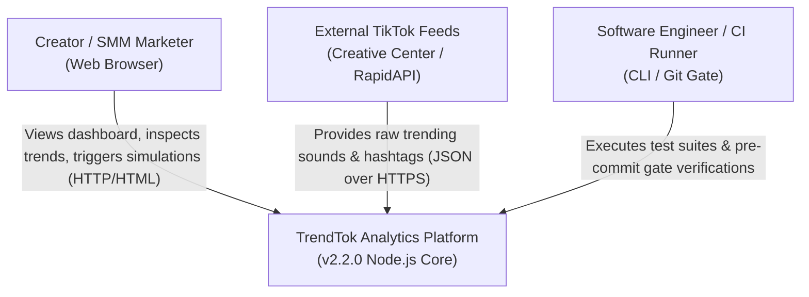
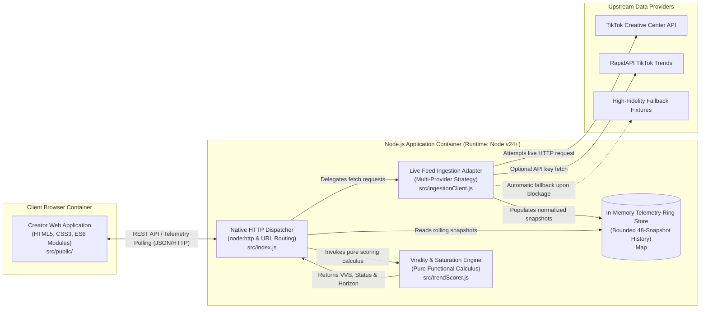
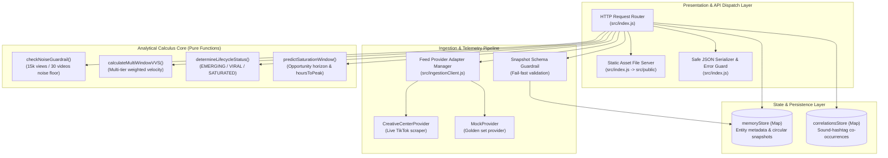
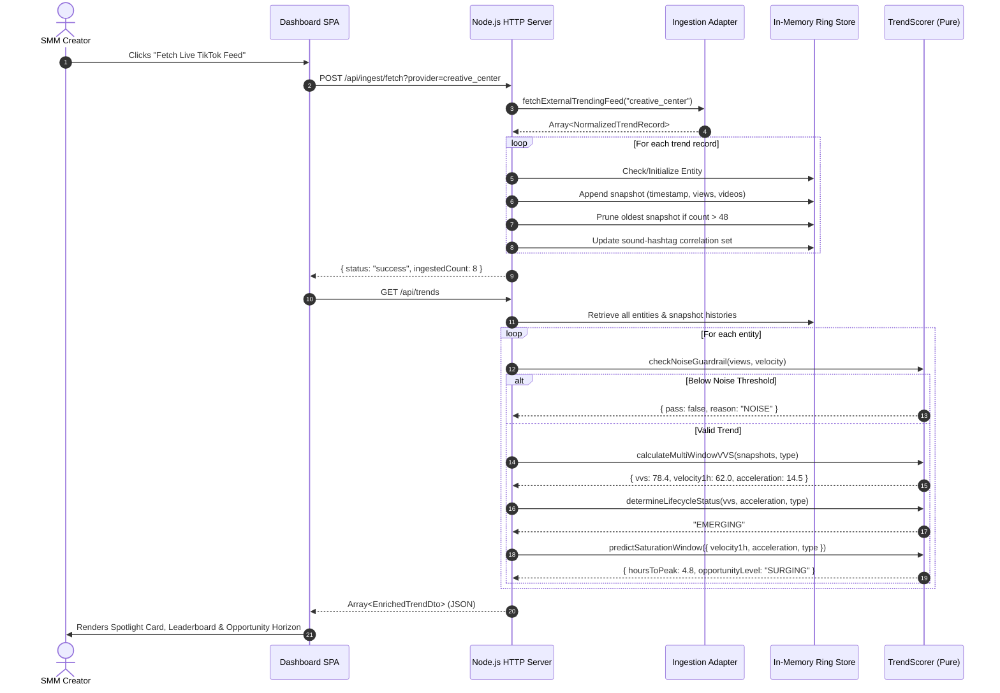
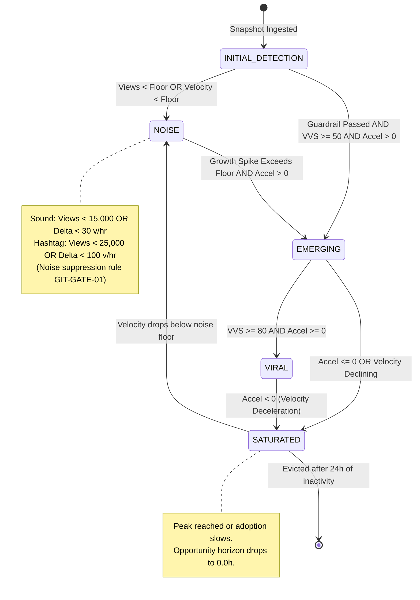

# Architecture Description: TrendTok Analytics
## Conforming to ISO/IEC/IEEE 42010:2011 & Kruchten 4+1 View Model

**System Name:** TrendTok Analytics  
**Version:** 2.3.0  
**Specification Reference:** SRS-TRENDTOK-2026-V2  
**Author:** Lysak Kostiantyn (IV Year, Group KN-32)  
**Organization:** Igor Sikorsky Kyiv Polytechnic Institute (KPI), Department of System Design  
**Date of Architecture Baseline:** September 24, 2026  
**Methodology:** Specification-Driven Development (SDD) & Automated Verification Gate  

---

## 1. Context, Scope, and Architectural Mission

TrendTok Analytics is a specialized, lightweight, ultra-low-latency web analytics service designed to identify, quantify, and forecast the lifecycle of viral trends (audio sounds and hashtags) on the TikTok platform.

The architectural mission of the system is rooted in three foundational principles:
1. **Deterministic, Pure-Function Scoring**: All virality algorithms (Virality Velocity Score, acceleration, saturation forecasting) are isolated as pure mathematical functions with zero side effects, enabling microsecond evaluation latency ($<0.5\text{ ms}$) and absolute unit testability.
2. **Pluggable & Resilient Ingestion**: Real-world external TikTok trend feeds are ingested via an adapter strategy pattern with transparent fallback mechanics, isolating external API instability from the analytical core.
3. **Zero-Dependency Architecture**: Built on native Node.js (v24+ ES Modules) and pure browser standards (HTML5/CSS3/ES6), completely eliminating framework overhead, transpilation friction, and third-party dependency vulnerabilities.

---

## 2. Stakeholders & Architectural Concerns (ISO/IEC/IEEE 42010 §5.3)

| Stakeholder Role | Key Concerns & Requirements | Architectural Solution |
|---|---|---|
| **Content Creator / SMM Strategist** | Early viral discovery, actionable peak prediction window, zero noise. | Real-time leaderboard, Opportunity Horizon calculus (`REQ-FR-11`), sound-hashtag correlation clusters (`REQ-FR-05`). |
| **Software Architect** | Strict modularity, pure functions, specification-driven implementation. | Decoupled functional modules (`src/trendScorer.js`), automated pre-commit SDD gate (`scripts/gate-verify.js`). |
| **Site Reliability Engineer (SRE)** | Predictable memory consumption, fail-fast resilience, high availability. | In-memory circular ring buffer bounded to 48 snapshots per entity (24h TTL) (`REQ-NFR-02`). |
| **Verification & Quality Officer** | Full requirements traceability, zero regression, standard compliance. | 100% Traceability Matrix (`spec/traceability_matrix.md`), CI pre-commit verification. |

---

## 3. C4 Architecture Views

### 3.1 Level 1: System Context Diagram

The System Context diagram outlines the interactions between human actors, the TrendTok Analytics platform, and upstream data sources.

---

### 3.2 Level 2: Container Diagram

The Container diagram illustrates the runtime boundary and deployment units comprising TrendTok Analytics.

---

### 3.3 Level 3: Component Diagram

The internal structural decomposition of the server container into distinct architectural components.

---

## 4. Behavioral & Dynamic Processes

### 4.1 Ingestion & Scoring Telemetry Sequence

The following sequence details how an external trend record is fetched, validated, persisted in the ring buffer, evaluated through the analytical calculus, and delivered to the dashboard.

---

## 5. Trend Lifecycle State Machine Model

Trends progress through defined states governed by deterministic criteria established in `spec/srs.md`.

---

## 6. Algorithmic Formulation

### 6.1 Multi-Window Virality Velocity Score (VVS)

Let $\Delta v_{1h}, \Delta v_{6h}, \Delta v_{24h}$ be the video adoption increments over 1-hour, 6-hour, and 24-hour observation windows. The scaled window velocities are:

$$S_k = \min\left(100.0, \; \frac{\Delta v_k}{\Delta t_k \cdot C_{type}}\right)$$

Where $C_{type}$ represents the entity-specific adoption ceiling constant:
* $C_{sound} = 50.0 \text{ videos/hour}$
* $C_{hashtag} = 250.0 \text{ videos/hour}$

The composite Virality Velocity Score is calculated as a weighted linear combination:

$$VVS = w_1 S_{1h} + w_2 S_{6h} + w_3 S_{24h}$$

With default weights $w_1 = 0.60, w_2 = 0.30, w_3 = 0.10$. When multi-hour historical windows are still accumulating, weights are dynamically normalized to preserve scale invariance.

### 6.2 Acceleration & Saturation Trajectory Prediction

The acceleration $a$ represents the discrete second derivative of adoption velocity:

$$a = \Delta v_{1h}(t_0) - \Delta v_{1h}(t_{-1})$$

The saturation horizon (estimated hours remaining until adoption velocity reaches the category ceiling) is modeled as:

$$T_{peak} = \begin{cases} 
0.0, & \text{if } v_{1h} \ge C_{type} \text{ (PEAK)} \\ 
0.0, & \text{if } a \le 0 \text{ (PLATEAU)} \\ 
\max\left(0.5, \; \frac{C_{type} - v_{1h}}{\max(0.1, a)}\right), & \text{if } a > 0 \text{ (SURGING)} 
\end{cases}$$

---

## 7. Quality Attribute Realization (ISO/IEC 25010)

| Quality Attribute | Architectural Tactic | Empirical Verification |
|---|---|---|
| **Performance Efficiency (Time Behavior)** | Pure functions, zero memory allocations in hot scoring loop, O(1) ring buffer access. | `test/trendScorer.test.js`: Benchmark executes under 0.5ms per VVS calculus (observed avg: ~0.08ms). |
| **Resource Utilization** | Bounded storage per entity (maximum 48 snapshot records); eviction of stale records. | Tested via rolling window test assertions; memory footprint remains constant under continuous simulation. |
| **Maintainability & Modularity** | Separation into pure domain logic (`src/trendScorer.js`), ingestion (`src/ingestionClient.js`), and server dispatch (`src/index.js`). | 100% pure ES Modules; zero circular dependencies; automated verification via AST parsing in gate script. |
| **Reliability & Fault Tolerance** | Ingestion strategy fallback chain; fail-fast schema validation; default metric sanitization (`Number(v) \|\| 0`). | Negative test suite in `tests/trendScorer.test.js` and `tests/api.test.js` validating resilience against `NaN`, `null`, negative values. |

---

## 8. Requirements Traceability Verification

All components and algorithms in this architecture description are mapped directly to requirements in [`spec/traceability_matrix.md`](../spec/traceability_matrix.md):

* **`REQ-FR-01` .. `REQ-FR-04`**: In-Memory Store & HTTP Telemetry API (`src/index.js`).
* **`REQ-FR-05`**: Sound-Hashtag Correlation Engine (`src/index.js`).
* **`REQ-FR-06` .. `REQ-FR-07`**: VVS Calculus, Guardrail, and Lifecycle Engine (`src/trendScorer.js`).
* **`REQ-FR-08`**: Real-Time Web Dashboard SPA (`src/public/`).
* **`REQ-FR-09`**: Interactive Simulation Controller (`src/index.js`).
* **`REQ-FR-10`**: Pluggable Live Feed Ingestion Adapter (`src/ingestionClient.js`).
* **`REQ-FR-11`**: Predictive Trajectory & Saturation Horizon Engine (`src/trendScorer.js`).
* **`REQ-FR-12`**: Native Embedded SQLite Multi-Tier Persistence & 7d Retention (`src/db.js`, `data/trendtok.db`).
* **`REQ-FR-13`**: High-Scale Corpus Generator & Ingestion (1,000–2,500+ Items) (`src/ingestionClient.js`).
* **`REQ-FR-14`**: Direct TikTok Deep-Linking Architecture (`src/public/dashboard.js`, `src/index.js`).
* **`REQ-FR-15`**: Scalable Dashboard with Pagination (25/50/100) & Deep-Dive Telemetry Inspector (`src/public/`).
* **`REQ-NFR-01` .. `REQ-NFR-04`**: Latency, TTL Bounding, Error Handling, Pure Functions (`src/trendScorer.js`, `scripts/gate-verify.js`).
