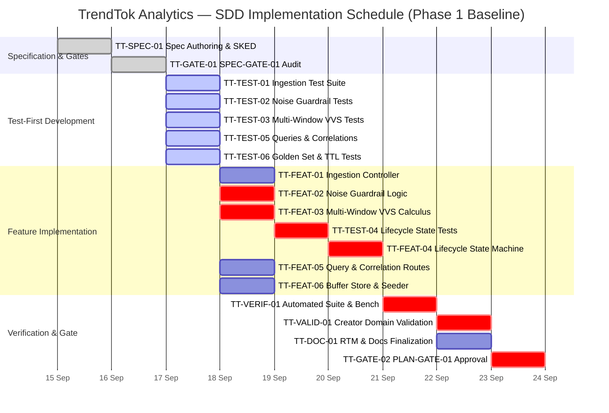

# SDD Project Plan & Risk Management Specification
## TrendTok Analytics — Lab 3 SDD Engineering Baseline

**Document Identifier:** `PLAN-RISK-TRENDTOK-2026-V1`  
**System Name:** TrendTok Analytics  
**Methodology:** Specification-Driven Development (SDD) & AI-Augmented Software Engineering  
**Lead Architect / Human:** Lysak Kostiantyn (IV Course, Group KN-32)  
**Coding Agent:** Google Antigravity (Gemini 3.8 Flash High)  
**Target Repository:** `lysakkostia/TrendTok-Analytics`  
**Date:** October 2026  

---

## 1. Bug Tracking System & SDD Workflow Configuration

### 1.1 Tool Selection: GitHub Issues & GitHub Projects
For tracking and orchestrating the SDD lifecycle of TrendTok Analytics, **GitHub Issues** in conjunction with **GitHub Projects (Beta Board)** is selected.
* **Rationale**:
  1. **Zero Context Switching**: Direct integration with Git repository, branches (`feat/*`, `agent/*`), commits, and pull requests.
  2. **Auditability**: Unalterable history of discussions, state changes, and reviews.
  3. **Label Taxonomy**: Native support for multi-dimensional labeling (Type, Role, Status, Milestone).
  4. **API Automations**: Programmatic manipulation via GitHub REST API / GraphQL for instant batch creation and synchronization.

### 1.2 Lifecycle States & Transition Rules
The bug tracking board enforces a 5-stage lifecycle designed to eliminate out-of-order development:

```
[ 1. Backlog ] ──► [ 2. To Do ] ──► [ 3. In Progress ] ──► [ 4. Under Verification ] ──► [ 5. Done ]
                          ▲                                            │
                          │                                            ▼
                          └─────────── [ Blocked by Gate ] ◄───────────┘
```

1. **Backlog**: Candidate requirements, deferred Addenda, and unapproved suggestions.
2. **To Do**: Tasks with satisfied dependencies ready for pickup in the current iteration.
3. **In Progress**: Active execution by the assigned role (Agent or Human). Max WIP = 3.
4. **Under Verification / Review**:
   * For Agent tasks: static linting, execution of `node:test`, and human cognitive code audit.
   * For Human tasks: consensus verification or cross-checking with SRS.
5. **Done**: Fully completed, merged, tested, and verified tasks satisfying Definition of Done (DoD).
6. **Blocked by Gate**: State when a task is waiting for a formal decision from a `Gate` checkpoint or when an upstream `Test` has failed.

### 1.3 SDD Ticket Types (8 Core Classes)
In accordance with SDD principles and Winston Royce's engineering foundations (1970):

1. **`Specification` (SPEC)**: Authoring, refining, or formalizing baseline requirements.
2. **`Addendum` (ADD)**: Formal modification or scope expansion of an already approved SRS baseline. Any feature not in the baseline must enter via an Addendum.
3. **`Test` (TEST)**: Automated test suites (`node:test`, assert) and verification scripts authored **before** production code.
4. **`Feature` (FEAT)**: Implementation of functional code strictly adhering to a requirement and blocked by its corresponding `Test`.
5. **`Verification` (VERIF)**: Automated execution checks (pipeline tests, benchmark < 0.5ms, memory profiling, type checks).
6. **`Validation` (VALID)**: Human assessment of fitness-for-purpose, real-world utility, and domain logic alignment.
7. **`Documentation` (DOC)**: Architectural guides (C4, ISO 42010), README, and glossary upkeep.
8. **`Gate` (GATE)**: Independent phase boundary decision checkpoint (Go / Revise / Stop). Produces no code; authorizes transitions.

---

## 2. Roles & Responsibility Distribution (Human vs. Coding Agent)

### 2.1 RACI Matrix for SDD Lifecycle

| Lifecycle Activity | Coding Agent (Antigravity) | Human Lead (Lysak Kostiantyn) | Principle & Boundary |
|---|:---:|:---:|---|
| **Concept & Intent Formulation** | Consulted (C) | Accountable & Responsible (A/R) | Machine cannot define business purpose. |
| **SRS Authoring (Initial Draft)** | Responsible (R) | Accountable & Approver (A) | Agent synthesizes structure; Human validates. |
| **Addendum Authoring** | Consulted (C) | Accountable & Responsible (A/R) | Scope expansions require deliberate human sign-off. |
| **Test Design (`Test-First`)** | Responsible (R) | Accountable & Reviewer (A) | Agent translates BDD/acceptance criteria to assertions. |
| **Feature Implementation** | Responsible (R) | Accountable & Reviewer (A) | Agent writes clean pure functions; Human audits edge cases. |
| **Automated Verification** | Responsible (R) | Informed (I) | CI/Node runner executes fast regression test runs. |
| **Domain Validation** | Non-participating | Accountable & Responsible (A/R) | Real creator workflow evaluation cannot be delegated. |
| **Stage-Gate Decision (`Gate`)** | Consulted (C) | **Sole Authority (A/R)** | **Machine is strictly forbidden from self-approving gates.** |

---

## 3. Work Breakdown Structure (WBS) & Ticket Decomposition

### 3.1 Baseline Phase 1 (Core SDD Release — Lab 2 Scope)

| Ticket ID | Type | Title & Objective | Target Requirement | Role | Dependencies (Blocked By) | Blocks | Estimated Agent Duration | Estimated Human Duration |
|---|---|---|---|:---:|---|---|:---:|:---:|
| **TT-SPEC-01** | `Specification` | Baseline SRS, Glossary & BDD Acceptance Scenarios | `REQ-FR-01..07`, `REQ-NFR-01..03` | Human + Agent | None | TT-GATE-01 | 15 min | 2.0 h |
| **TT-GATE-01** | `Gate` | **Audit SPEC-GATE-01**: Baseline verification & freeze | Baseline Scope | **Human** | TT-SPEC-01 | TT-TEST-01..03, TT-TEST-05..06 | 0 min | 1.0 h |
| **TT-TEST-01** | `Test` | Ingestion REST Contract Suite (`POST /api/snapshots`) | `REQ-FR-01`, `REQ-NFR-03` | Agent | TT-GATE-01 | TT-FEAT-01 | 5 min | 20 min |
| **TT-FEAT-01** | `Feature` | Ingestion HTTP Controller with fail-fast payload validation | `REQ-FR-01`, `REQ-NFR-03` | Agent | TT-TEST-01 | TT-VERIF-01 | 10 min | 15 min |
| **TT-TEST-02** | `Test` | Differentiated Noise Guardrail test suite (Sound vs Tag) | `REQ-FR-02` | Agent | TT-GATE-01 | TT-FEAT-02 | 5 min | 30 min |
| **TT-FEAT-02** | `Feature` | Pure algorithmic guardrail `checkNoiseGuardrail` | `REQ-FR-02` | Agent | TT-TEST-02 | TT-VERIF-01, TT-TEST-04 | 10 min | 20 min |
| **TT-TEST-03** | `Test` | Multi-Window Velocity ($V$) & VVS composite calculus | `REQ-FR-03`, `REQ-NFR-01` | Agent | TT-GATE-01 | TT-FEAT-03 | 8 min | 30 min |
| **TT-FEAT-03** | `Feature` | Mathematical engine `calculateMultiWindowVVS` | `REQ-FR-03`, `REQ-NFR-01` | Agent | TT-TEST-03 | TT-VERIF-01, TT-TEST-04 | 12 min | 25 min |
| **TT-TEST-04** | `Test` | State machine transitions (`NOISE`, `EMERGING`, `VIRAL`) | `REQ-FR-04` | Agent | TT-FEAT-02, TT-FEAT-03 | TT-FEAT-04 | 5 min | 20 min |
| **TT-FEAT-04** | `Feature` | State machine evaluator `determineLifecycleStatus` | `REQ-FR-04` | Agent | TT-TEST-04 | TT-VERIF-01 | 10 min | 20 min |
| **TT-TEST-05** | `Test` | Trends query & Sound-Hashtag correlation routes | `REQ-FR-05`, `REQ-FR-06` | Agent | TT-GATE-01 | TT-FEAT-05 | 6 min | 20 min |
| **TT-FEAT-05** | `Feature` | HTTP query endpoints (`/emerging`, `/correlations`) | `REQ-FR-05`, `REQ-FR-06` | Agent | TT-TEST-05 | TT-VERIF-01 | 12 min | 20 min |
| **TT-TEST-06** | `Test` | Golden Set simulation loader & 24h rolling TTL eviction | `REQ-FR-07`, `REQ-NFR-02` | Agent | TT-GATE-01 | TT-FEAT-06 | 5 min | 15 min |
| **TT-FEAT-06** | `Feature` | In-memory ring buffer store & seed generator | `REQ-FR-07`, `REQ-NFR-02` | Agent | TT-TEST-06 | TT-VERIF-01 | 10 min | 15 min |
| **TT-VERIF-01** | `Verification`| Automated test suite run (`node:test`) & latency benchmark | `REQ-NFR-01` | Agent | TT-FEAT-01..06 | TT-VALID-01, TT-DOC-01 | 2 min | 15 min |
| **TT-VALID-01** | `Validation`  | Human scenario evaluation of viral emergence | Business Objective | **Human** | TT-VERIF-01 | TT-GATE-02 | 0 min | 1.5 h |
| **TT-DOC-01**   | `Documentation`| Bidirectional RTM ticket mapping & execution guides | Project Documentation | Human + Agent | TT-VERIF-01 | TT-GATE-02 | 10 min | 30 min |
| **TT-GATE-02** | `Gate` | **Checkpoint PLAN-GATE / MVP-GATE**: Baseline Release Go | Phase 1 Milestones | **Human** | TT-VALID-01, TT-DOC-01 | Phase 2 Addenda | 0 min | 1.0 h |

### 3.2 Phase 2 & 3 Evolution (Evolutionary Addenda Roadmap)

| Ticket ID | Type | Title & Target Requirement | Addressed Need | Role | Depends On |
|---|---|---|---|:---:|---|
| **TT-ADD-01** | `Addendum` | Web Dashboard UI & Time-Step Simulation Controller (`REQ-FR-08`, `REQ-FR-09`) | Interactive visual exploration and sandbox time warp | Human + Agent | TT-GATE-02 |
| **TT-ADD-02** | `Addendum` | Pluggable External Feed Ingestion & Saturation Calculus (`REQ-FR-10`, `REQ-FR-11`) | Live TikTok feeds & remaining viral window prediction | Human + Agent | TT-ADD-01 |
| **TT-ADD-03** | `Addendum` | Native SQLite Store, High-Scale Corpus (1k+) & Deep-Links (`REQ-FR-12..15`) | Persistent disk storage, pagination, and direct URLs | Human + Agent | TT-ADD-02 |
| **TT-ADD-04** | `Addendum` | Chrome CDP Agent, Dual Forecasting & Triad Engine (`REQ-FR-16..18`) | Live TikTok scraping, logistic S-curves & 1-2-3 triads | Human + Agent | TT-ADD-03 |
| **TT-GATE-03** | `Gate` | **Checkpoint SCALE-SQLITE-GATE-01**: Database Schema & Invariants Audit | Ingestion scalability and data monotonicity | **Human** | TT-ADD-03 |

---

## 4. Phased Schedule, Gantt Chart & Critical Path Analysis

### 4.1 Gantt Chart (Calendar Execution Sequence)



### 4.2 Critical Path Method (CPM) Determination
The Critical Path represents the chain of dependent activities that determines the minimum total project duration. Any delay on this path directly postpones the delivery date:

$$\text{Critical Path} = \text{TT-SPEC-01} \rightarrow \text{TT-GATE-01} \rightarrow \text{TT-TEST-02 / 03} \rightarrow \text{TT-FEAT-02 / 03} \rightarrow \text{TT-TEST-04} \rightarrow \text{TT-FEAT-04} \rightarrow \text{TT-VERIF-01} \rightarrow \text{TT-VALID-01} \rightarrow \text{TT-GATE-02}$$

* **Critical Path Justification**:
  1. The core viral scoring engine (`REQ-FR-02`, `REQ-FR-03`) is the mathematical dependency foundation for the lifecycle state machine (`REQ-FR-04`).
  2. While simple API handlers (`TT-FEAT-01`, `TT-FEAT-05`, `TT-FEAT-06`) can proceed in parallel, the lifecycle state transitions cannot be tested or coded until the noise guardrail and velocity calculus are verified.
  3. Final verification (`TT-VERIF-01`), human scenario validation (`TT-VALID-01`), and gate approval (`TT-GATE-02`) strictly gate deployment.

### 4.3 Human Bottleneck Analysis (Royce 1970 Principles)
* **Agent Execution Metric**: The coding agent performs technical syntax synthesis in seconds to minutes ($\sum T_{\text{agent}} \approx 1.8\text{ hours}$).
* **Human Cognitive Metric**: The human developer requires sustained attention for specification cross-checking, formal reviews, and edge-case validation ($\sum T_{\text{human}} \approx 9.5\text{ hours}$).
* **Engineering Insight**: The AI coding agent shifts the software development constraint from *typing speed and syntax lookup* to **human cognitive bandwidth and decision velocity**. Without disciplined gates, an agent creates code faster than a human can audit, leading to catastrophic context drift and latent bug accumulation.

---

## 5. Risk Management Register (AI-Augmented SDD Pipeline)

### 5.1 Risk Taxonomy & Scoring Grid
Risk Priority is computed as $\text{RPN} = \text{Likelihood (1..5)} \times \text{Impact (1..5)}$:
* **Low**: $1 - 6$
* **Medium**: $8 - 12$
* **High / Critical**: $15 - 25$

### 5.2 Comprehensive Risk Register

| Risk ID | Risk Category | Risk Title & Description | Manifestation | Impact & Consequences | Likelihood | Impact | Score | Detection Strategy | Mitigation & Control Action |
|---|---|---|---|---|:---:|:---:|:---:|---|---|
| **RSK-AI-01** | AI Pipeline | **Requirements Misinterpretation (Drift)** | Agent alters mathematical definitions (e.g. uniform noise thresholds instead of differentiated). | False positives in viral detection; garbage leaderboard. | 4 | 5 | **20 (High)** | Automated diff inspection between SRS formulas and AST; unit tests checking exact boundary values. | Enforce single source of truth (`spec/srs.md`); freeze SRS at `SPEC-GATE-01`. |
| **RSK-AI-02** | AI Pipeline | **Code-Test Sycophancy (Error Correlation)** | Agent writes both feature and test simultaneously, tailoring test assertions to pass broken code. | False sense of security; production failure with 100% green tests. | 4 | 5 | **20 (High)** | Independent human code review of assertions; testing with synthetic golden fixtures. | **Strict Test-First isolation**: test tickets (`TT-TEST-*`) authored and reviewed before feature code (`TT-FEAT-*`). |
| **RSK-AI-03** | AI Pipeline | **Context Window Degradation / Staleness** | In long conversations, agent forgets early architectural constraints (e.g. introduces CommonJS or drops TTL). | Architectural erosion, build regressions, memory leaks. | 3 | 4 | **12 (Med)** | Automated gate verification script (`scripts/gate-verify.js`) auditing architectural invariants. | Project rules pinned in `GEMINI.md`; concise subagent scoping; frequent repository synchronization. |
| **RSK-AI-04** | AI Pipeline | **Non-Determinism in Code Synthesis** | Same prompt yields different implementations across iterations, producing erratic diffs. | Git history pollution, unstable refactorings, flaky tests. | 3 | 3 | **9 (Med)** | Git staged diff review prior to every commit; deterministic test seeds. | Pure function architectures with zero global side-effects; pinning prompts to exact function signatures. |
| **RSK-AI-05** | AI Pipeline | **Tool Invocation & File Execution Errors** | Agent runs unauthorized commands or creates misnamed paths. | Broken workspace tree, accidental overwriting of artifacts. | 2 | 4 | **8 (Med)** | Agent tool call logging, workspace read-write sandboxing. | Workspace guidelines explicitly prohibiting `cd` commands; mandatory review of file diffs. |
| **RSK-AI-06** | AI Pipeline | **Human Rubber-Stamping (Oversight Failure)** | Human approves agent proposals without deep cognitive audit due to fatigue. | Latent defects escape to main; architectural debt. | 4 | 4 | **16 (High)** | Mandatory checklist protocols for every Gate decision record in `/logs`. | Enforce explicit phase gates (`SPEC-GATE`, `PLAN-GATE`, `CODE-GATE`) with formal Go/Revise logs. |
| **RSK-TR-01** | Traditional | **TikTok Rate Limiting & Anti-Scraping** | Live TikTok endpoints return HTTP 429 / 403 or captcha challenges. | Ingestion pipeline blackout during live trend monitoring. | 4 | 4 | **16 (High)** | HTTP telemetry logging; mock mode fallback indicators. | Decoupled collectors; offline synthetic fallback generator (`ingestionClient.js`); headless Chrome agent. |
| **RSK-TR-02** | Traditional | **Micro-Sample Noise Amplification** | Viral score spikes on items with 1 video and 5 views ($100\%$ velocity). | SMM creators waste budget on spam tags. | 4 | 5 | **20 (High)** | Boundary unit tests for 0, 1, 10 views against noise filters. | Mathematical Noise Guardrails (`REQ-FR-02`) enforced before any velocity calculus. |
| **RSK-TR-03** | Traditional | **Memory Saturation under High Throughput** | In-memory store accumulates snapshots unbounded over time. | Node.js process Out-Of-Memory (OOM) crash. | 2 | 5 | **10 (Med)** | Process heap telemetry in `/api/health`. | 24-hour sliding window TTL auto-pruning (`REQ-NFR-02`) and native SQLite indexing (`REQ-FR-12`). |

### 5.3 High-Cost-of-Failure Requirements & Enhanced Gate Controls

Certain requirements carry severe repercussions if breached. These are subjected to enhanced gate controls:

1. **`REQ-FR-02` (Differentiated Noise Guardrails)**:
   * *Failure Impact*: Flawed market intelligence delivered to paying creators.
   * *Control*: Must pass dedicated negative boundary test suites (zero delta, micro-delta below 30/100) before unlocking `TT-FEAT-04`.
2. **`REQ-FR-03` (Multi-Window VVS Calculus)**:
   * *Failure Impact*: Score instability and mathematical divergence (division by zero, NaN propagation).
   * *Control*: Mathematical invariant assertions and execution latency benchmark ($< 0.5\text{ ms}$) verified in `TT-VERIF-01`.
3. **`REQ-NFR-03` (Fail-Fast Input Validation)**:
   * *Failure Impact*: Corrupted memory state or SQLite injection.
   * *Control*: Strict JSON schema validation asserting HTTP 400 on malformed payloads.

---

## 6. Audit & Repository Anchoring

This plan and its risk mitigation measures are permanently recorded in the project repository:
* Specification Document: [`docs/plan_and_risks.md`](plan_and_risks.md)
* Traceability Updates: [`spec/traceability_matrix.md`](../spec/traceability_matrix.md)
* Gate Audit Protocol: [`logs/plan_gate_decision.md`](../logs/plan_gate_decision.md)
